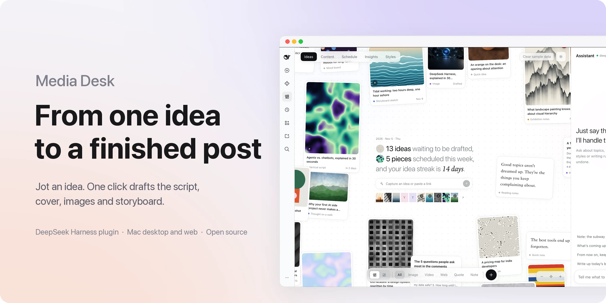
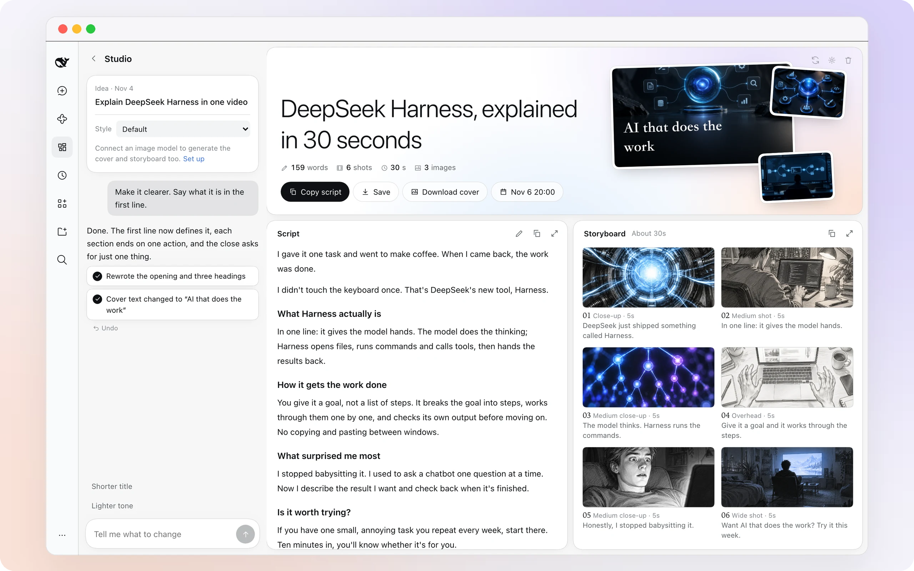
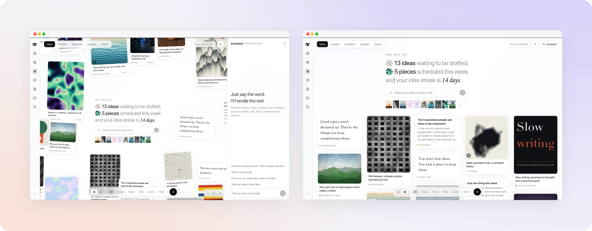

<p align="center">
  <picture>
    <source media="(prefers-color-scheme: dark)" srcset="docs/assets/hero-en-dark.webp">
    
  </picture>
</p>

<h1 align="center">Media Workbench</h1>

<p align="center"><b>A DeepSeek Harness content workspace: capture ideas, draft content, schedule posts and review results in one place.</b></p>

<p align="center">
  <a href="#get-started">Install</a> ·
  <a href="#features">Features</a> ·
  <a href="#models-and-services">Models and services</a> ·
  <a href="#faq">FAQ</a> ·
  <a href="README.md">简体中文</a>
</p>

<p align="center">
  
  
  <a href="LICENSE"></a>
</p>

<br>

## What it is

Media Workbench is a content workspace that runs in the DeepSeek Harness sidebar. Save an idea, a link or a piece of media, then generate a title, spoken script, cover, images and a six-frame storyboard. Schedule the finished piece on the calendar and review its performance later.

The interface is available in English and Chinese. It works in the desktop and web versions, and keeps your data on your computer unless you configure an external service.

## Features

### Draft a complete piece in one click

<table>
<tr>
<td width="62%">
  <picture>
    <source media="(prefers-color-scheme: dark)" srcset="docs/assets/f-studio-en-dark.webp">
    
  </picture>
</td>
<td valign="top">
<p><b>Generate the whole structure.</b></p>
<p>The title, script, cover, images and six storyboard frames are generated together and appear as each one is ready.</p>
<p><b>Ask for a change.</b></p>
<p>Rewrite a title, change the tone, revise one storyboard frame or redraw an image in a sentence. Every change can be undone.</p>
<p><b>Export and use it.</b></p>
<p>Edit and copy the script, or save the complete piece to one folder.</p>
</td>
</tr>
</table>

### Ideas, scheduling, insights and styles

<table>
<tr>
<td valign="top" width="38%">
<p><b>Capture ideas quickly.</b> Text, links, images, videos and quotes become cards. Use an infinite canvas or a date-sorted feed.</p>
<p><b>Find related ideas.</b> Enter a keyword and related cards are grouped by relevance.</p>
<p><b>Keep creating.</b> Schedule finished pieces, review trends and platform breakdowns, and turn useful patterns into writing rules.</p>
<p><b>Choose a voice.</b> Use the built-in presets or learn an editable style card from your own posts.</p>
</td>
<td>
  <picture>
    <source media="(prefers-color-scheme: dark)" srcset="docs/assets/f-home-en-dark.webp">
    
  </picture>
</td>
</tr>
</table>

The workspace supports content planning for RedNote, Douyin, Bilibili, WeChat, TikTok, Instagram, YouTube and X. Publishing still happens manually on each platform.

## Get started

Requires DeepSeek Harness `0.2.1-rc.5` or later in the `0.2.x` line.

**1. Install.** The package `media-workbench` is published on npm. Choose the source you want to install from:

From npm (recommended):

```bash
dsh plugin --profile desktop add media-workbench
dsh plugin --profile web add media-workbench
```

From the current checkout (recommended for development):

```bash
dsh plugin --profile desktop add "file:/absolute/path/to/media-workbench"
dsh plugin --profile web add "file:/absolute/path/to/media-workbench"
```

From GitHub:

```bash
dsh plugin --profile desktop add github:xuanzai92/media-workbench
dsh plugin --profile web add github:xuanzai92/media-workbench
```

A GitHub install runs `prepare` locally to build the browser half at `dist/client.js`. If pnpm asks you to allow the build, add this to `$DSH_HOME/profiles/<profile>/pnpm-workspace.yaml` and run the install again:

```yaml
allowBuilds:
  media-workbench: true
```

You can also run `npm pack` in the repository and install the resulting tarball. The tarball already contains the built browser half:

```bash
npm pack
dsh plugin --profile web add "file:/absolute/path/to/media-workbench-1.0.0.tgz"
```

The desktop Plugins → Add plugin flow can also accept `media-workbench`.

Quit the desktop app completely (⌘Q) before installing and reopen it afterwards. For the web version, restart `dsh web`. If the `dsh` command is not available, enable it from the desktop app menu.

**2. Open.** Media Workbench appears in the sidebar. The first launch includes sample data; clear it from the top right when you are ready to use your own content.

**3. Update or uninstall.** Run the install command again to update. Replace `add` with `remove` to uninstall.

```bash
dsh plugin --profile desktop remove media-workbench
```

Uninstalling does not delete your content. State, settings and imported media are stored in `~/.dsh/media-workbench/` by default and can be moved in Settings. **Save drafts to** controls the export folder separately.

## Models and services

The plugin is free and open source. It ships with no API keys and uses the accounts you configure in DeepSeek Harness or in the plugin settings.

| Feature | Configuration | Without it |
| --- | --- | --- |
| Titles, scripts and storyboard text | Your text model in DeepSeek Harness | A structural outline |
| Covers, images and storyboard frames | An OpenAI-compatible image API or a registered DSH image tool | Text still works and the cover uses a text-only fallback |
| Account import and analytics | A RedFox API key (optional) | Enter numbers manually or paste posts to learn a style |

Image APIs use `POST {endpoint}/images/generations`. Common providers are pre-filled, and custom endpoints are supported. Image keys stay in the local `settings.json`; they are not written into content data or sent to the text model.

When DSH image tools are selected, Media Workbench reuses a compatible registered image tool. If the tool or host version is unavailable, switch back to an HTTP image API.

## Import your own account

In Styles or Insights, click **Import account** and paste your profile link. Supported platforms include RedNote, Douyin, Bilibili, TikTok, Instagram and X. Only public content is read; the imported posts, engagement data and learned style stay in the local workspace.

Add a [RedFox API Key](https://redfox.hk/apis?source=doc) in Settings before the first import. Available fields and pricing depend on RedFox and your account balance. Import only accounts you are allowed to use and follow each platform's rules.

## FAQ

<details>
<summary><b>Can I use it without an image model?</b></summary>
<br>

Yes. Titles, scripts and storyboard text still work, and the cover uses a text-only fallback. Connect an image model to generate covers, images and frames.

</details>

<details>
<summary><b>Can it publish to platforms for me?</b></summary>
<br>

No. The workspace handles planning, generation, scheduling and review. Copy the content or save the folder, then publish it yourself.

</details>

<details>
<summary><b>Does my data go to the cloud?</b></summary>
<br>

State, settings and imported media stay on your computer by default. Only the external model, image or RedFox service you configure receives the data needed for its request.

</details>

<details>
<summary><b>Is this an official DeepSeek product?</b></summary>
<br>

No. Media Workbench is an independently maintained community plugin.

</details>

## Development

```bash
npm install
npm test                   # host logic tests
npm run build              # build client/dist
npm run watch              # rebuild when client/ changes
scripts/dev-sandbox.sh     # run the web version in an isolated DSH_HOME
node scripts/mock-llm.mjs  # use local mock models without quota
npm pack                   # create the installable tgz
```

| Path | Contents |
| --- | --- |
| `client/` | UI: ideas, studio, chat, content, schedule, insights, styles and settings |
| `src/` | Host routes, drafting pipeline, prompts, image generation, style learning, account import and local storage |
| `scripts/` | Bundling, sandbox, mock models and sample asset generation |
| `assets/` | Sample images and videos |
| `docs/assets/` | README screenshots |
| `test/` | Host, i18n, image and import tests |

Restart DeepSeek Harness after changing `src/`. The Host route prefix is `/media-workbench/`, and local uploads and generated media use `media-workbench/files/...` URIs.

## Feedback and security

- Project: [github.com/xuanzai92/media-workbench](https://github.com/xuanzai92/media-workbench)
- Issues: [GitHub Issues](https://github.com/xuanzai92/media-workbench/issues)
- Security: report privately through [Security Advisories](https://github.com/xuanzai92/media-workbench/security/advisories/new)

Every route is authenticated by the host. Model output and fetched content are reduced to the fields the app needs and length-limited, operations are allow-listed, and external links cannot reach localhost or private networks.

<br>

<p align="center"><sub><a href="LICENSE">MIT</a> · A community plugin, not affiliated with DeepSeek. DeepSeek Harness and its marks belong to their respective owners.</sub></p>
