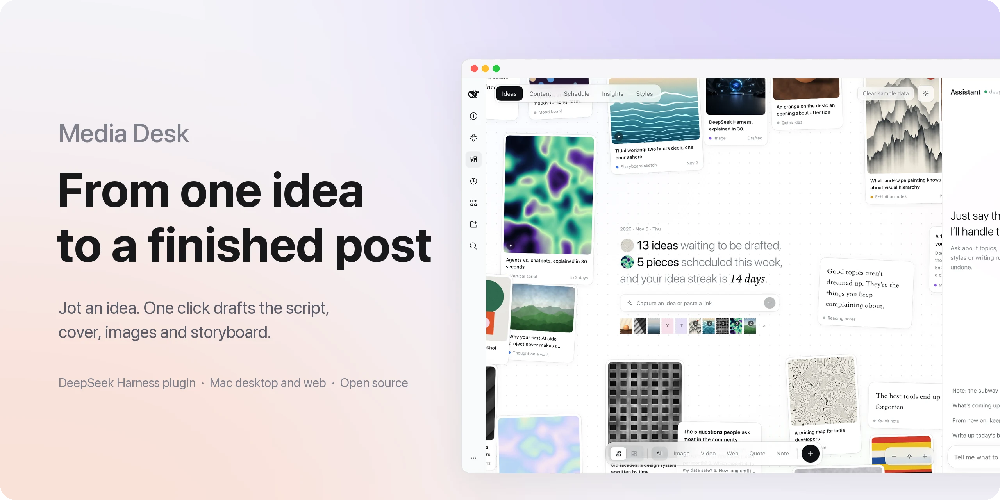

<p align="center"></p>

# Media Workbench

Media Workbench is a DeepSeek Harness plugin for discovering topics, collecting ideas, creating content, scheduling publication, and reviewing performance. It works with the desktop and web versions. The current interface is in Chinese.

[中文](README.md) · [Features](#features) · [Installation](#installation) · [Configuration and data](#configuration-and-data) · [Development](#development)

## Features

- **Trends and rankings:** Browse AI Hot news and trending stories, popular posts on X, and RedFox rankings for Xiaohongshu and Douyin. Filter results and save or collect items as ideas. RedFox rankings currently use the Digital & Technology category.
- **Ideas:** Save notes, quotes, links, images, and videos. Browse, filter, and organize them on a free-form canvas or in a feed; discover related ideas and combine multiple ideas into one draft.
- **Creation:** Turn ideas into articles, image posts, or video scripts. Articles include a title, full text, and inline images; image posts include a title, short copy, and ordered images; video creation includes a spoken script, cover, and storyboard. Edit, request changes in chat, undo edits, and retry individual images.
- **Content management and export:** Search, sort, and manage content status in a board or table. Copy full articles and image posts or export them as Markdown with images; export video scripts, covers, and storyboards. The workbench flags fallback text, missing images, and individual image failures, and can export the current version before all issues are resolved.
- **Scheduling and publishing handoff:** Drag ideas or drafts onto the calendar. Completed drafts can be handed off to Aibeike; select the platform and finish publishing there. If the extension does not receive the handoff, copy the content and media links instead.
- **Insights:** Enter metrics manually, paste CSV data, or import public data from your own account to review trends, platform distribution, and content performance. Learn writing rules from the data.
- **Style and assistant:** Use or edit style presets, or extract a personal style from text, links, or a public account. Manage writing rules and export them as a Skill. The side assistant can answer questions about the workbench and help with actions.
- **Local Markdown:** Store ideas, drafts, and attachments locally in a configurable data directory, sync with Obsidian, and import Markdown from `外部采集/`.

## Installation

Requires DeepSeek Harness `>=0.2.1-rc.5 <0.3.0` and Node.js 20 or later. Install for the profiles you use:

```bash
dsh plugin --profile desktop add media-workbench
dsh plugin --profile web add media-workbench
```

You can also enter `media-workbench` under Plugins → Add Plugin in the desktop app. Quit the desktop app completely before installing from the command line, then reopen it; restart `dsh web` after installing for the web profile. If `dsh` is unavailable, enable the command-line tool from the desktop app menu.

Open Media Workbench from the sidebar. The first launch includes sample data, which you can clear using the sample-data button. To update, run the installation command again; to uninstall, replace `add` with `remove`. Uninstalling the plugin does not delete your content.

For local development, install the checkout with `dsh plugin --profile web add "file:/absolute/path/media-workbench"`. The npm release may differ from the current repository code.

## Configuration and data

Choose a data directory in the workbench settings and configure external services as needed:

| Purpose | Configuration and limitations |
| --- | --- |
| Text generation | Uses the text model configured in DeepSeek Harness; when unavailable, a fallback outline is generated for review. |
| Image generation | Configure an OpenAI-compatible `/images/generations` API or use a supported DSH image tool. Text generation remains available without an image service. |
| Account imports and social rankings | Configure a [RedFox API key](https://redfox.hk/apis?source=doc). Account imports support public data from Xiaohongshu, Douyin, Bilibili, TikTok, Instagram, and X; available fields and costs depend on the service. |

The default data directory is `~/.dsh/media-workbench/` and can be changed in settings. Its main contents are:

```text
外部采集/          Incoming external Markdown
灵感/<id>.md       Ideas
内容/<id>/内容.md  Drafts
attachments/       Images, videos, and other attachments
state.json         Workbench state
```

The workbench syncs ideas and drafts to Markdown. Open the workbench or select “Sync local Obsidian content” in settings to read local changes. Files in `外部采集/` move to `灵感/` after a successful import; failed files remain for retry. Imports from `内容选题/<author>/*.md` are also supported. The entire data directory can be used as an Obsidian vault. Deleting an idea or draft in the workbench also deletes its corresponding Markdown file or draft directory.

State, settings, and media are stored locally. When you use models, rankings, account imports, or the publishing handoff, relevant data is sent to the corresponding service. Image and RedFox keys are stored in local settings. Export checks local images first; missing files or external images not yet saved as local attachments block export.

## Development

```bash
npm install
npm test
npm run build             # Build dist/client.js
npm run watch
scripts/dev-sandbox.sh    # Start the web app with an isolated DSH_HOME
node scripts/mock-llm.mjs # Use a local mock model
```

`client/` contains the interface, `src/` the Host and application logic, and `test/` the tests. Restart DeepSeek Harness after Host changes; rebuild and refresh after interface changes.

[Report an issue](https://github.com/xuanzai92/media-workbench/issues) · [Report a security issue](https://github.com/xuanzai92/media-workbench/security/advisories/new) · [MIT License](LICENSE)

This is an independently maintained community plugin and is not affiliated with DeepSeek.
