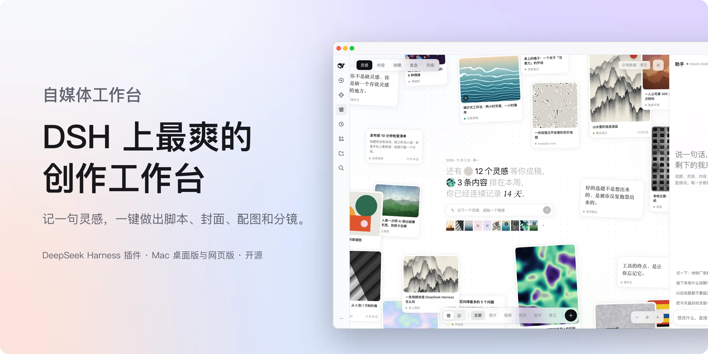

<p align="center"></p>

# Media Workbench

Media Workbench 是 DeepSeek Harness 的内容创作插件，帮助你发现选题、收集灵感、生成内容、安排发布并复盘表现，支持桌面版和网页版。当前界面为中文。

[English](README.en.md) · [功能](#功能) · [安装](#安装) · [配置与数据](#配置与数据) · [开发](#开发)

## 功能

- **热点与榜单**：浏览 AI Hot 的资讯和热点事件、X 热门内容，以及 RedFox 的小红书和抖音榜单；支持筛选并将感兴趣的内容收藏或采集到灵感。RedFox 榜单当前固定为「数码科技」赛道。
- **灵感**：保存笔记、金句、链接、图片和视频，在自由画布或信息流中浏览、筛选和整理；查看相关灵感，也可以选择多条灵感合并成稿。
- **创作**：基于灵感生成文章、图文或视频脚本。文章包含标题、正文和文内配图；图文包含标题、短配文和有序图片；视频创作包含口播脚本、封面和分镜。支持编辑、对话修改、撤销及单张配图重试。
- **内容管理与导出**：在看板或表格中搜索、排序和管理内容状态。文章和图文可复制全文或导出 Markdown 与图片；视频可导出脚本、封面和分镜。生成结果会提示文字降级、缺图和图片失败，未补齐时也可导出当前版本。
- **排期与发布交接**：在日历中拖动灵感或成稿安排日期。完成的成稿可交接给爱贝壳，仍需在爱贝壳选择平台并完成发布；扩展未接收时可以复制内容和素材链接。
- **复盘**：手动录入、粘贴 CSV 或导入自己的公开账号数据，查看趋势、平台分布和内容表现，并从数据中学习写作规则。
- **风格与助手**：使用或编辑预设风格，从文字、链接或公开账号提炼个人风格；管理写作规则并导出为 Skill。侧边助手可回答工作台相关问题并协助操作。
- **本地 Markdown**：将灵感、成稿和附件保存在本机，支持自定义数据目录，与 Obsidian 内容同步，并导入 `外部采集/` 中的 Markdown。

## 安装

需要 DeepSeek Harness `>=0.2.1-rc.5 <0.3.0` 和 Node.js 20 或更高版本。选择需要的 profile 安装：

```bash
dsh plugin --profile desktop add media-workbench
dsh plugin --profile web add media-workbench
```

也可在桌面版的「插件」→「添加插件」中输入 `media-workbench`。命令行安装前请完全退出桌面版，安装后重新打开；网页版安装后重启 `dsh web`。如果找不到 `dsh`，先在桌面版菜单中启用命令行工具。

打开侧栏中的「自媒体工作台」即可开始。首次使用会显示示例数据，可通过「示例数据 · 清空」移除。更新时重新执行安装命令；卸载时将 `add` 改为 `remove`，卸载插件不会删除内容。

本地开发版本可使用 `dsh plugin --profile web add "file:/绝对路径/media-workbench"` 安装。npm 发布版本的功能可能与此仓库当前代码不同。

## 配置与数据

在工作台设置中选择数据目录，并按需配置外部服务：

| 用途 | 配置与限制 |
| --- | --- |
| 文字生成 | 使用 DeepSeek Harness 中配置的文字模型；不可用时会生成需要核对的结构草稿。 |
| 图片生成 | 配置兼容 OpenAI `/images/generations` 的图片 API，或使用受支持的 DSH 生图工具；未配置时仍可生成文字。 |
| 账号导入和社媒榜单 | 配置 [RedFox API Key](https://redfox.hk/apis?source=doc)。账号导入支持小红书、抖音、B 站、TikTok、Instagram 和 X 的公开数据；可用字段和费用以服务为准。 |

默认数据目录为 `~/.dsh/media-workbench/`，可在设置中更改。主要文件包括：

```text
外部采集/          外部 Markdown 输入目录
灵感/<id>.md       灵感
内容/<id>/内容.md  成稿
attachments/       图片、视频等附件
state.json         工作台状态
```

工作台会同步灵感和成稿的 Markdown；打开工作台或在设置中点击「同步本地 Obsidian 内容」可读取本地变更。`外部采集/` 中的文件成功导入后会移入 `灵感/`，失败的文件会保留以便重试；也兼容导入 `内容选题/<作者>/*.md`。可将整个数据目录作为 Obsidian vault 使用。删除工作台中的灵感或成稿时，对应的 Markdown 文件或成稿目录也会删除。

状态、设置和媒体保存在本机；使用模型、榜单、账号导入或发布交接时，相关数据会发送给对应服务。图片和 RedFox 密钥保存在本机设置中。导出前会检查本地图片是否可用；缺失或尚未转为本地附件的外链图片会阻止导出。

## 开发

```bash
npm install
npm test
npm run build             # 构建 dist/client.js
npm run watch
scripts/dev-sandbox.sh    # 使用隔离的 DSH_HOME 启动网页版
node scripts/mock-llm.mjs # 使用本地模拟模型
```

`client/` 是界面，`src/` 是 Host 和业务逻辑，`test/` 是测试。修改 Host 后需要重启 DeepSeek Harness；修改界面后需要重新构建并刷新。

[问题反馈](https://github.com/xuanzai92/media-workbench/issues) · [安全问题](https://github.com/xuanzai92/media-workbench/security/advisories/new) · [MIT License](LICENSE)

本项目是独立维护的社区插件，与 DeepSeek 无关。
