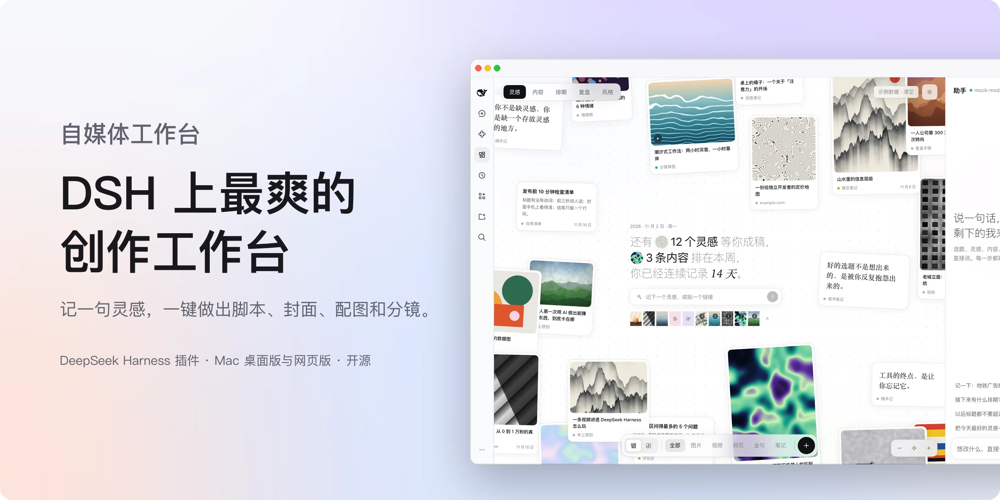
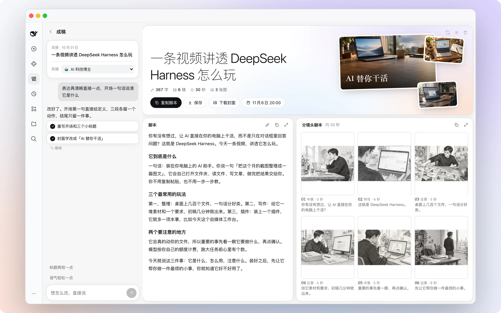
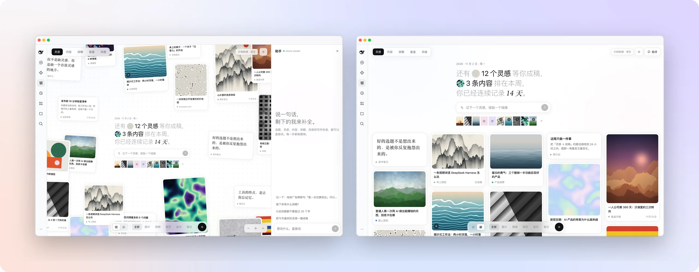
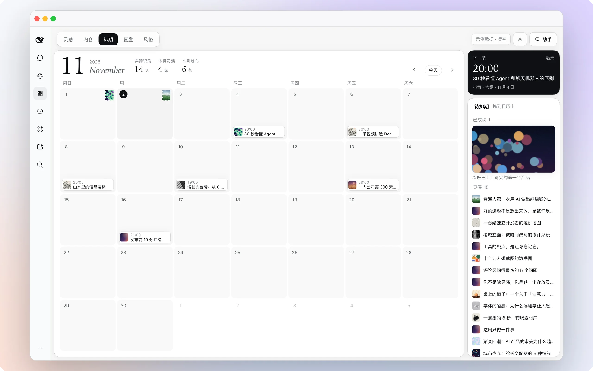

<p align="center">
  <picture>
    <source media="(prefers-color-scheme: dark)" srcset="docs/assets/hero-zh-dark.webp">
    
  </picture>
</p>

<h1 align="center">Media Workbench</h1>

<p align="center"><b>DeepSeek Harness 的内容创作工作台：记灵感、做成稿、排期和复盘，一处完成。</b></p>

<p align="center">
  <a href="#三步上手">安装</a> ·
  <a href="#功能">功能</a> ·
  <a href="#模型与服务">模型与服务</a> ·
  <a href="#问答">问答</a> ·
  <a href="README.en.md">English</a>
</p>

<p align="center">
  
  
  <a href="LICENSE"></a>
</p>

<br>

## 它是什么

Media Workbench 是一个装在 DeepSeek Harness 侧栏里的内容创作工作台。把一句灵感、一个链接或一段素材记下来，就能继续生成标题、口播脚本、封面、配图和六格分镜；完成后拖到日历排期，再回到复盘页查看表现。

工作台支持中文和英文界面，桌面版和网页版都能使用。内容默认保存在本机，可以切换到自定义目录。

## 功能

### 一键成稿

<table>
<tr>
<td width="62%">
  <picture>
    <source media="(prefers-color-scheme: dark)" srcset="docs/assets/f-studio-dark.webp">
    
  </picture>
</td>
<td valign="top">
<p><b>一次生成完整结构。</b></p>
<p>标题、脚本、封面、配图和六格分镜会同时生成，完成一项就显示一项。</p>
<p><b>用一句话修改。</b></p>
<p>可以要求改写标题、调整语气、修改某一格分镜或重画某张图，每一步都能撤销。</p>
<p><b>导出后直接使用。</b></p>
<p>脚本可以继续编辑和复制，也可以把整篇内容保存到一个文件夹。</p>
</td>
</tr>
</table>

### 灵感墙

<table>
<tr>
<td valign="top" width="38%">
<p><b>随手记，自动整理。</b></p>
<p>文字、链接、图片、视频和金句都可以保存为卡片。支持自由画布和按时间排列的信息流。</p>
<p><b>相关内容会聚在一起。</b></p>
<p>输入关键词后，已有相关灵感会按关联程度排列到旁边。</p>
<p><b>侧边助手随时可用。</b></p>
<p>可以直接询问今天的灵感、近期排期，或修改后续写作规则。</p>
</td>
<td>
  <picture>
    <source media="(prefers-color-scheme: dark)" srcset="docs/assets/f-home-dark.webp">
    
  </picture>
</td>
</tr>
</table>

### 排期、复盘和风格

<table>
<tr>
<td width="62%">
  <picture>
    <source media="(prefers-color-scheme: dark)" srcset="docs/assets/f-schedule-dark.webp">
    
  </picture>
</td>
<td valign="top">
<p><b>排期。</b> 把成稿拖到日历中的某一天，管理待发布内容和连续创作记录。</p>
<p><b>复盘。</b> 手动录入、粘贴 CSV，或导入自己的账号，查看趋势、平台分布和表现较好的内容。</p>
<p><b>风格。</b> 使用内置风格预设，或从自己的账号和文章中提炼一张可以继续编辑的风格卡。</p>
</td>
</tr>
</table>

支持小红书、抖音、B 站、公众号，以及 TikTok、Instagram、YouTube 和 X 的内容整理与排期。平台发布仍需手动完成。

## 三步上手

要求 DeepSeek Harness `0.2.1-rc.5` 及以上的 `0.2.x` 版本。

**1. 安装。** 这个仓库目前还没有发布到 npm。按你使用的来源选择一种安装方式：

当前目录开发（推荐）：

```bash
dsh plugin --profile desktop add "file:/绝对路径/media-workbench"
dsh plugin --profile web add "file:/绝对路径/media-workbench"
```

从 GitHub 安装：

```bash
dsh plugin --profile desktop add github:xuanzai92/media-workbench
dsh plugin --profile web add github:xuanzai92/media-workbench
```

GitHub 安装会在本机执行 `prepare` 来生成浏览器端的 `dist/client.js`。如果 pnpm 提示需要允许构建，在对应 profile 的 `$DSH_HOME/profiles/<profile>/pnpm-workspace.yaml` 中加入下面的配置，再重新执行安装：

```yaml
allowBuilds:
  media-workbench: true
```

也可以先在仓库目录执行 `npm pack`，再安装生成的 tarball；这种方式已经包含构建后的浏览器端文件：

```bash
npm pack
dsh plugin --profile web add "file:/绝对路径/media-workbench-2.6.2.tgz"
```

如果以后把包发布到 npm，才可以在桌面版「插件」→「添加插件」中输入 `media-workbench`，或直接执行 `dsh plugin --profile <profile> add media-workbench`。

命令行安装前，桌面版需要完全退出（⌘Q），安装后重新打开；网页版安装后重启 `dsh web`。如果终端里没有 `dsh`，先在桌面版菜单中启用命令行工具。

**2. 打开。** 侧栏会出现「自媒体工作台」。第一次打开会有示例数据，确认流程后可以点击右上角「示例数据 · 清空」。

**3. 更新或卸载。** 更新时重新执行安装命令；卸载时将 `add` 换成 `remove`。

```bash
dsh plugin --profile desktop remove media-workbench
```

卸载不会删除内容。状态、设置和导入媒体默认保存在 `~/.dsh/media-workbench/`，可以在设置中改成自定义本地路径；「成稿保存到」单独控制导出的文件夹。

## 模型与服务

插件本身免费开源，不包含任何密钥。需要模型的功能使用你在 DeepSeek Harness 中配置的账号。

| 功能 | 配置 | 未配置时 |
| --- | --- | --- |
| 写标题、脚本和分镜文案 | DeepSeek Harness 中的文字模型 | 生成结构草稿 |
| 生成封面、配图和分镜图 | OpenAI 兼容的图片接口，或 DSH 已注册的生图工具 | 仍可生成文字，封面使用纯文字版本 |
| 导入账号和数据 | RedFox API Key（可选） | 手动录入数据，或粘贴内容提炼风格 |

图片接口使用 `POST {接口地址}/images/generations`。设置中提供常见服务的预设，也可以填写自定义地址。生图密钥只保存在本机 `settings.json`，不会写入内容数据或发送给文字模型。

如果选择 DSH 生图工具，工作台会复用已注册且兼容的图片工具；工具未安装、宿主版本不支持或账号额度不足时，可以切回 HTTP 图片接口。

## 导入自己的账号

在「风格」或「复盘」页点击「导入账号」，粘贴自己的主页链接。支持小红书、抖音、B 站、TikTok、Instagram 和 X。只读取公开内容，导入后会更新内容数据、互动数据和风格信息。

首次使用需要在设置中填写 [RedFox API Key](https://redfox.hk/apis?source=doc)。实际可读取的字段和费用以 RedFox 接口与账户余额为准。请只导入自己有权使用的账号，并遵守平台规则。

## 问答

<details>
<summary><b>没有生图模型也能用吗？</b></summary>
<br>

能。标题、脚本和分镜文案仍然可以生成，封面会使用纯文字版本。接入图片模型后，封面、配图和分镜图也会生成。

</details>

<details>
<summary><b>可以直接发布到平台吗？</b></summary>
<br>

不能。工作台负责整理、生成、排期和复盘，发布需要你复制内容或保存文件后手动完成。

</details>

<details>
<summary><b>数据会上传到云端吗？</b></summary>
<br>

状态、设置和导入媒体默认保存在本机。只有你主动配置的模型、图片服务或 RedFox 会收到对应请求所需的数据。

</details>

<details>
<summary><b>这是 DeepSeek 官方产品吗？</b></summary>
<br>

不是。Media Workbench 是社区插件，与 DeepSeek 独立维护。

</details>

## 开发

```bash
npm install
npm test                  # Host 逻辑测试
npm run build             # 构建 client/dist
npm run watch             # 监听 client/ 并重新打包
scripts/dev-sandbox.sh    # 在隔离的 DSH_HOME 中运行网页版
node scripts/mock-llm.mjs # 使用本地模拟模型，不消耗额度
npm pack                  # 生成可安装的 tgz
```

| 目录 | 内容 |
| --- | --- |
| `client/` | 界面：灵感墙、成稿、对话、内容、排期、复盘、风格和设置 |
| `src/` | Host 接口、成稿流水线、提示词、生图、风格提炼、账号导入和本地存储 |
| `scripts/` | 打包、沙盒、模拟模型和示例素材生成 |
| `assets/` | 示例图片和视频 |
| `docs/assets/` | README 展示图 |
| `test/` | Host、国际化、生图和导入相关测试 |

修改 `src/` 后需要重启 DeepSeek Harness。Host 接口前缀是 `/media-workbench/`，本地上传和生成的媒体使用 `media-workbench/files/...` URI。

## 反馈与安全

- 项目主页：[github.com/xuanzai92/media-workbench](https://github.com/xuanzai92/media-workbench)
- 问题反馈：[Issues](https://github.com/xuanzai92/media-workbench/issues)
- 安全问题：请通过 [Security Advisories](https://github.com/xuanzai92/media-workbench/security/advisories/new) 私下报告

每个接口都经过 Host 鉴权；模型输出和外部内容只保留需要的字段并限制长度，操作走白名单；外部链接不能访问本机和内网。

<br>

<p align="center"><sub><a href="LICENSE">MIT</a> · 社区插件，与 DeepSeek 无关。DeepSeek Harness 的名称和标识归其所有者所有。</sub></p>
